 
 
&nbsp;
&nbsp;
&nbsp;

 
 

  

  

<table>
  <tr>
    <td width="60%" align="center">
      
    </td>
    <td width="40%" align="center">
      
    </td>
  </tr>
</table>

 

  

<!--
Prefer your real contribution graph? Run the "Generate contribution snake" workflow once, then swap the line above for:

-->

  

