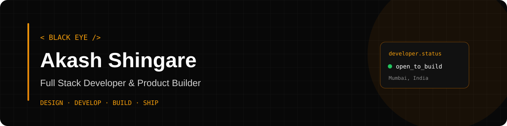
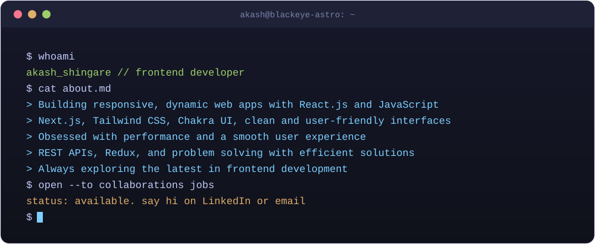

<div align="center">



### Full Stack Developer | UI/UX Enthusiast | Product Builder

Building modern web applications and meaningful digital experiences.

[](YOUR_PORTFOLIO_URL)
[](YOUR_LINKEDIN_URL)
[](https://github.com/BLACKEYE-ASTRO)

</div>

---

## `whoami`

```bash
$ whoami
Akash Shingare

$ role
Full Stack Developer

$ current_focus
Building scalable web applications
Creating better user experiences
Learning system design and backend architecture

$ philosophy
Think. Design. Develop. Ship.
```

I am a developer passionate about building modern digital products,
from intuitive user interfaces to scalable backend systems.

I enjoy turning ideas into functional products,
solving real-world problems and continuously improving my engineering skills.

---

## What I Build

| Area | Focus |
|---|---|
| Web Development | React, Next.js, TypeScript |
| Backend Development | Node.js, Express.js, REST APIs |
| Database | MongoDB, PostgreSQL, Prisma |
| UI/UX Design | Figma, Responsive Design |
| Tools | Git, GitHub, Postman, VS Code |

---

## Tech Stack

**Frontend**


**Backend & Database**


**Design & Tools**


---

## Featured Projects

### Notoir
Modern note-taking application inspired by Notion.

**Stack:** Next.js · Prisma · PostgreSQL · Convex · Tailwind CSS

[View Project](https://notoir.vercel.app/)

### Wealthly
Personal finance management application.

**Stack:** Next.js · Prisma · PostgreSQL · Clerk

### Sticky Chats
Real-time chat application.

**Stack:** React · Node.js · Express · Socket.IO · MongoDB

---

## GitHub Analytics

<div align="center">


</div>

---

## Contribution Activity

<div align="center">

</div>

---

## Developer Mode

<div align="center">

</div>

---

<div align="center">

### Let's build something meaningful.

Open to interesting projects, collaborations and opportunities.

[Portfolio](YOUR_PORTFOLIO_URL) · [LinkedIn](YOUR_LINKEDIN_URL) · [GitHub](https://github.com/BLACKEYE-ASTRO)



</div>
